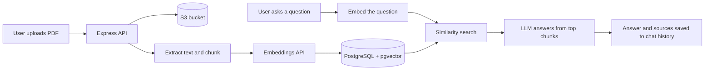

# DocMind

**Upload a document, ask questions, get answers with sources.**

DocMind is a full-stack Retrieval-Augmented Generation (RAG) app. Users sign up, upload PDFs, and chat with their documents. Answers are generated by an LLM using only the most relevant passages from the uploaded file, and every conversation is saved so users can come back to it later.

> **Status:** in active development. See [Roadmap](#roadmap) for what is built and what is next.

---

## Features

- **Authentication:** register and log in with email and password. Passwords are hashed with bcrypt and sessions use signed JWTs.
- **Document upload:** PDFs are validated (type and size), stored in a private S3 bucket, and processed in the backend.
- **RAG pipeline:** text extraction, overlapping chunking, embeddings, and similarity search with pgvector.
- **Grounded answers:** the LLM answers from retrieved chunks, and the source passages are shown with each answer.
- **Chat history:** every user has their own conversations and messages, saved in PostgreSQL.
- **Per-user data:** every query is filtered by user, so users only see their own documents and chats.
- **Swappable LLM provider:** OpenAI first, with a provider abstraction so Gemini can be added without restructuring.

## Tech stack

| Layer | Technology |
| --- | --- |
| Frontend | React (Vite), Axios, React Router, react-markdown |
| Backend | Node.js, Express |
| Database | PostgreSQL with the `pgvector` extension |
| File storage | AWS S3 (private bucket, presigned URLs) |
| AI | OpenAI embeddings (`text-embedding-3-small`) and chat model (`gpt-4o-mini`) |
| Auth | bcryptjs, JSON Web Tokens |
| Deployment | Render (backend), Vercel (frontend) |

## How it works



1. **Upload:** the PDF is held in memory, saved to S3, and its text is extracted.
2. **Chunking:** the text is split into overlapping chunks so context is not lost at the edges.
3. **Embedding:** each chunk is converted to a vector and stored in the `chunks` table.
4. **Retrieval:** a question is embedded, and the closest chunks are found with pgvector's cosine distance.
5. **Generation:** the question and the retrieved chunks are sent to the LLM, which answers using only that context.
6. **History:** the question, answer, and source chunks are saved to the conversation.

## Project structure

```
docmind-rag/
  backend/
    db/
      schema.sql                 # full database schema
    src/
      config/                    # env, database, S3 client
      middleware/                # auth, upload (multer), error handling
      modules/
        auth/                    # register, login, current user
        documents/               # upload flow, parsing, chunking
        storage/                 # S3 upload and presigned URLs
        embeddings/              # embedding generation and storage
        chat/                    # retrieval and answer generation
        conversations/           # saved chats and messages
        llm/                     # provider abstraction (OpenAI, Gemini)
      utils/                     # chunker, logger
      app.js                     # Express app and route mounting
      server.js                  # entry point
  frontend/
    src/
      components/                # upload, chat, layout, common
      hooks/                     # useUpload, useChat, auth hooks
      services/                  # API client and service modules
      pages/                     # Login, Register, Home
```

The backend follows a modular layout: routes stay thin, controllers handle HTTP, services hold the logic, and models hold the SQL. The frontend keeps components presentational and pushes API logic into hooks and services.

## Getting started

### Prerequisites

- Node.js 18 or newer
- PostgreSQL 14 or newer with the `pgvector` extension available
- An OpenAI API key
- An AWS account with an S3 bucket and an IAM user that can read and write to it

### 1. Clone the repository

```bash
git clone https://github.com/Tanveeraly/docmind-rag.git
cd docmind-rag
```

### 2. Set up the database

```bash
createdb docmind
psql -d docmind -f backend/db/schema.sql
```

The schema file enables the `vector` extension and creates five tables: `users`, `documents`, `chunks`, `conversations`, and `messages`.

### 3. Run the backend

```bash
cd backend
npm install
```

Create `backend/.env` (see [Environment variables](#environment-variables)), then:

```bash
npm run dev
```

The API runs on `http://localhost:5000`. Check `http://localhost:5000/api/health`, which should return `{"status":"ok"}`.

### 4. Run the frontend

```bash
cd frontend
npm install
npm run dev
```

Create `frontend/.env` with `VITE_API_URL=http://localhost:5000`. The app runs on `http://localhost:5173`.

## Environment variables

### Backend (`backend/.env`)

| Variable | Description |
| --- | --- |
| `PORT` | Port for the API (default `5000`) |
| `DATABASE_URL` | PostgreSQL connection string |
| `FRONTEND_URL` | Allowed CORS origin (default `http://localhost:5173`) |
| `JWT_SECRET` | Long random string used to sign tokens |
| `JWT_EXPIRES_IN` | Token lifetime (default `7d`) |
| `AWS_REGION` | Region of your S3 bucket |
| `AWS_ACCESS_KEY_ID` | IAM user access key |
| `AWS_SECRET_ACCESS_KEY` | IAM user secret key |
| `S3_BUCKET_NAME` | Name of the private bucket for uploads |
| `OPENAI_API_KEY` | OpenAI API key |

Generate a strong JWT secret with:

```bash
node -e "console.log(require('crypto').randomBytes(48).toString('hex'))"
```

### Frontend (`frontend/.env`)

| Variable | Description |
| --- | --- |
| `VITE_API_URL` | Base URL of the backend API |

Never commit `.env` files. Both are listed in `.gitignore`.

## API reference

All routes are prefixed with `/api`. Protected routes need the header `Authorization: Bearer <token>`.

### Implemented

| Method | Route | Auth | Description |
| --- | --- | --- | --- |
| GET | `/health` | No | Service health check |
| POST | `/auth/register` | No | Create an account, returns user and token |
| POST | `/auth/login` | No | Log in, returns user and token |
| GET | `/auth/me` | Yes | Get the current user |

### Planned

| Method | Route | Description |
| --- | --- | --- |
| POST | `/documents` | Upload a PDF, process and index it |
| GET | `/documents` | List the current user's documents |
| DELETE | `/documents/:id` | Delete a document, its chunks, and its S3 file |
| GET | `/conversations` | List saved chats |
| GET | `/conversations/:id/messages` | Load a chat's messages |
| POST | `/chat` | Ask a question and get an answer with sources |

Route names for planned endpoints may change as they are built.

## Security notes

- Passwords are hashed with bcrypt (cost factor 12) and are never returned by the API.
- Login and registration are rate limited.
- Uploads are limited to PDFs of 10 MB or less.
- The S3 bucket is private, and files are shared only through short-lived presigned URLs.
- Use a dedicated IAM user with only `s3:PutObject` and `s3:GetObject` on the one bucket.
- Every data query is scoped by the authenticated user's ID.
- Set a monthly spending limit on your OpenAI account and a budget alert on AWS.

## Deployment

- **Backend (Render):** deploy the `backend` folder as a Web Service. Set all backend environment variables in the Render dashboard, and use a managed PostgreSQL instance that supports `pgvector`. Run `db/schema.sql` against it once.
- **Frontend (Vercel):** deploy the `frontend` folder and set `VITE_API_URL` to your Render URL.
- **CORS:** set `FRONTEND_URL` on the backend to your Vercel URL.

## Roadmap

- [x] Project structure and database schema
- [x] Express app, PostgreSQL connection, health check
- [x] Authentication (register, login, current user)
- [ ] PDF upload to S3, text extraction, chunking
- [ ] Embeddings and pgvector similarity search
- [ ] Chat endpoint with grounded answers and source citations
- [ ] Saved conversations and message history
- [ ] React frontend: auth pages, upload, chat, conversation sidebar
- [ ] Deployment to Render and Vercel
- [ ] Gemini as a second LLM provider
- [ ] Streaming responses
- [ ] Refresh tokens

## Author

**Tanveer Ali**, Full-Stack Developer
[GitHub](https://github.com/Tanveeraly) | [LinkedIn](https://linkedin.com/in/tanvir-aly) | tanveerali.ask@gmail.com

## License

MIT